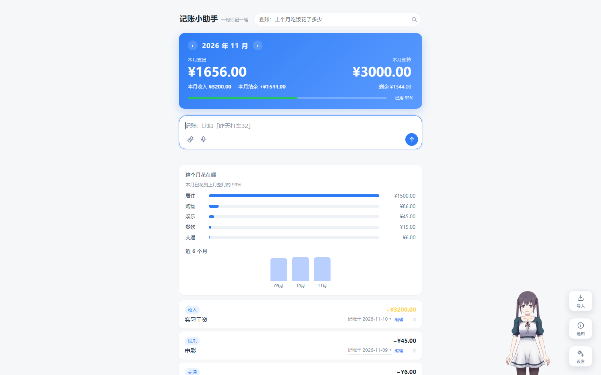
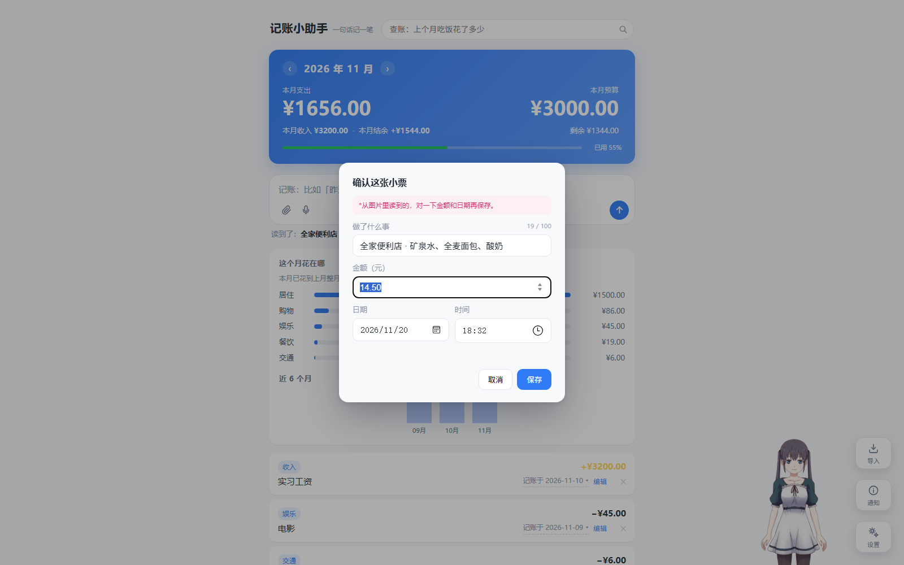
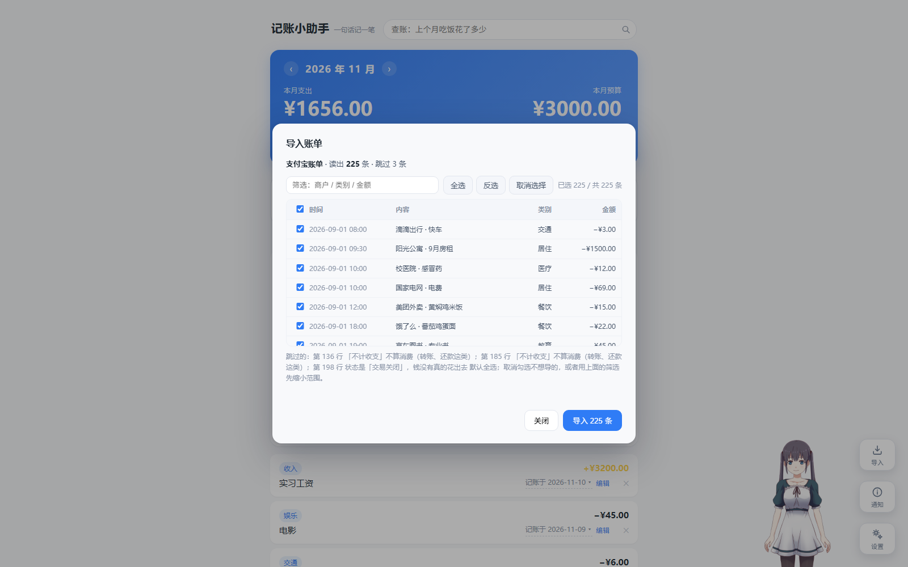

# 个人记账与消费分析 AI 助手

> 2026 GDUF 人工智能工作室二轮考核 · 方向一（AI 应用）
>
> 一句话 / 一张小票 → 结构化账目 → 数据库 → 统计 / 查账 / 预算

## 项目简介

传统记账要逐笔选分类、填金额，几周之后就没人再打开。这个项目让用户**说一句话**（「昨天打车 32」）完成记账，
系统自动解析金额、日期、类别并入库；查账时也**问一句话**（「上个月吃饭花了多少」），
不用在筛选器里点半天。

**设计底线：数字不经过模型。** 模型（含规则解析器）只负责把自然语言翻译成结构化查询，
所有金额和统计都由 SQL 算出——所以页面上的数字永远能和数据库对上。



> 截图用的是 `samples/demo.csv` 那套演示数据，不是真实账目。

## 现在到哪了

MVP 四项全部打通：**自然语言记账 + 小票 OCR、自动分类与统计、自然语言查账、预算与超支提醒**。
在这之上补了账单导入（CSV / Excel，带勾选和筛选）、AA 平摊、查账跳页、操作历史与撤销。
Docker 已在 2026-11-28 重新构建、启动通过（新增 OCR / 导入之后），容器内接口全部 200；
数据走 bind mount，`down` 再 `up` 不会丢。

| 能力 | 说明 |
| --- | --- |
| 记账 | 一句话 → 金额 / 日期 / 时刻 / 类别；规则优先、模型兜底；支持语音、多笔和 AA |
| 小票 OCR | 图片 → 金额 / 商户 / 时间；进编辑框确认后才入库，读不出就直说 |
| 导入 | 微信 / 支付宝 / 通用 CSV、Excel；先预览，可筛选勾选，按（时间 + 金额 + 文字）去重 |
| 查账 | 「问题 → DSL → SQL → 一句话」；认不出就问模型，再不行说没看懂 |
| 统计与预算 | 分类横条、近 6 个月趋势；预算按生效区间存，85% / 95% 变色提醒 |
| 记账卫生 | 整数分、软删除、操作留痕 66 天、可撤销；编辑有修改史 |
| 上手引导 | 没账时首页三张卡（说一句 / 拍小票 / 导账单）+「设置 → 使用说明」 |

分页、主题、月份切换这类基础交互不在这里展开，用一下就知道。

想直接看效果：起服务后导入 `samples/demo.csv`（225 条模拟账单，覆盖 9~11 月），
卡片、统计、查账立刻就有数据。

评估时最值得看的三处：自然语言记账的解析链路、查账的「问题 → DSL → SQL」、以及操作历史与撤销。
贯穿全项目的两条原则是：**数字不经过模型**、**看不懂就说不懂，不替用户编数据**。

## 环境要求

- **Windows 10 / 11**（开发环境；服务端本身跨平台，浏览器录音也不挑系统）
- **Python 3.14**（开发环境 3.14.8，依赖版本见 `requirements.lock.txt`）
- 麦克风（只有语音记账需要）
- Docker（只有容器化部署需要，可选）

## 快速开始

```powershell
# 1. 建虚拟环境
python -m venv .venv

# 2. 装依赖（requirements.txt 首行已指向清华源，境外网络可删掉那行）
.\.venv\Scripts\python.exe -m pip install -r requirements.txt

# 3.（可选）想用语音记账或小票 OCR 才需要密钥
copy .env.example .env
#   然后编辑 .env，填上 DEEPSEEK_API_KEY=sk-xxxx

# 4. 启动——双击 start.bat 最省事，它会自动打开浏览器
#    或者手动：
.\.venv\Scripts\python.exe -m uvicorn app:app --reload --port 8000
#    http://127.0.0.1:8000       记账页面
#    http://127.0.0.1:8000/docs  自动生成的接口文档
```

**不配密钥也能跑**：打字记账、统计、查账、账单导入全部可用；语音和小票 OCR 需要云端识别，
没 key 时这两项会提示「缺少 API Key」。

### 容器化

```powershell
copy .env.example .env      # 密钥通过 env_file 注入容器
docker compose up --build
# 浏览器打开 http://127.0.0.1:8000
docker compose down
```

数据库和录音通过 `volumes` 挂在 `./data`，**删容器不会丢账**。
镜像只装 `requirements-web.txt` 里的精简依赖，不含本地模型 / 桌面端那些重依赖。

> 国内构建提示：拉基础镜像超时时设 `BASE_IMAGE=镜像加速地址`；
> 容器内 pip 连不上源时，`docker-compose.yml` 里的 `network: host` 已经帮你绕开 WSL2 的 DNS 问题。

## 配置密钥

密钥**不进代码、不进仓库**，只放在本地 `.env` 里：

| 文件 | 是否提交 | 内容 |
| --- | --- | --- |
| `.env.example` | ✅ 提交 | 模板，值为空 |
| `.env` | ❌ 已 gitignore | 你的真实 key |

`.env` 在启动时被 `config.py` 读进环境变量，代码里只用 `os.environ` 取值；
已存在的环境变量优先，方便临时覆盖。Docker 里通过 compose 的 `env_file` 注入，同样不进镜像。

界面上改的东西**不写回 `.env`**，而是存到 `data/settings.json`——因为这个文件跟着数据卷走，
本地和容器里都能持久化（`.env` 在镜像里是不存在的，容器也写不进宿主机）。

优先级：**`data/settings.json` > `.env` > 代码默认值**。
想清空界面里存的 key，在设置里清空输入框再保存即可，会自动回退到 `.env`。
没配 key 时首页顶部会有一条提醒（能手动关掉）：语音和小票 OCR 用不了，记账、统计、查账、导入照常。

语音识别只有云端一种（DeepSeek），没 key 就用不了；本地模型已经拆掉了（模型 1.5 GB、
镜像装不下、维护成本也不值）。

小票 OCR 没有单独的开关：它跟 LLM 共用这个 key、走同一个云端接口。
本地 OCR 在评估中（依赖、模型分发、准确率都要算），结论和原因写在 [docs/design.md](docs/design.md) 的 5.1 节。

## 怎么用

- **第一次用**：还没有账目时，首页会给出三张卡片（说一句 / 拍小票 / 导账单），
  点一下直接进对应流程；之后随时可以在「设置 → 使用说明」里翻到同样的内容。
- **记账**：聊天框里写一句（「昨天打车32」）→ 回车或点右下角的 ↑，下方会回显「理解为：交通 · −¥32.00 · 日期」
  - 支持「22点」「晚上10点」这类时刻；「打车32，吃饭15」会拆成两笔
  - **AA 会自动平摊**：「四个舍友aa 15.6」记 3.90；除不尽会弹编辑框让你确认
  - 「最近」「月底」这种说不清日期的词会被拦下，不替你编日期
- **查账**：标题右边的搜索框（「上个月吃饭花了多少」）→ 答案和解析结果贴在下面；
  问具体某天（「10月1日花了多少」）会把卡片和流水一起翻到那天。看不懂不会瞎答。
- **小票 / 截图**：点聊天框左下角的回形针，或把图片拖进去 → 读出金额 / 商户 / 时间 →
  先弹编辑框核对，保存才入库。想试的话仓库里有张合成小票 `samples/receipt_demo.png`。

  

- **导入账单**：回形针 / 拖文件 / 右下角「导入」，支持 CSV 和 Excel；
  先预览（可筛选、勾选、全选 / 反选），只导勾中的；微信、支付宝、自己做的表都能认。

  

- **预算**：卡片右栏，每月默认 + 当月单独设；85% 转黄、95% 转红，超支直接写「超支 ¥xxx」。
- **语音**：聊天框左下角的麦克风，点一下开始、再点一下结束。
- **编辑 / 删除 / 撤销**：流水右侧；删错了去「历史记录」撤销，所有操作留痕 66 天。
- **设置**：右下角齿轮：主题与背景图、预算、模型（本地 / 云端）、历史记录。

## 目录结构

一句话版：`app.py` 接 HTTP，`parser.py` / `llm.py` / `receipt.py` / `importer.py` 把各种输入变成账目草稿，
`storage.py` 落 SQLite，`query.py` 把问题变成 SQL，`templates/index.html` 是整个前端。

逐文件说明见 [docs/structure.md](docs/structure.md)。

## 接口一览

27 个接口，按资源分组的清单（含参数和返回要点）见 [docs/api.md](docs/api.md)。
FastAPI 自动生成的文档在 `/docs`，可以直接点开试。

## 技术说明

### 查账为什么要「问题 → DSL → SQL」

如果直接把问题丢给模型让它回答，模型会编数字，而且没法对账。这里是三段式：

```
问题 ──规则解析──▶ DSL ──代码拼 SQL──▶ 数据库算 ──模板──▶ 一句话
                    ↑ 类别/时间/聚合都是白名单，参数绑定
```

- SQL 的聚合函数只能从 `sum / count / avg / balance` 里取，其余全是 `?` 占位
- 用户输入**一个字符都不会拼进 SQL**
- 页面上把 DSL 显示出来，评审能直接看到「它把问题理解成了什么」
- `balance`（结余）是唯一一条不吃「方向」过滤的：它要同时算收入和支出，
  用 `sum(case when kind='income' then amount else -amount end)` 一句算完

### 看不懂的问题，不能硬答

以前不管问什么，规则都会兜到「这个月 + 合计」，于是「草泥马」也会得到
「这个月一共 39.00 元」——**比报错更糟**，用户会以为系统真懂了。

现在的判定顺序：

```
有疑问/聚合词（多少、几笔、结余、收入…）且时间说法规则认得？
                     │是 → 规则直接答（毫秒级）
                     │
        否 ──▶ 问一次模型：这是不是在问账？ ──是──▶ 用模型给的日期区间查
                     │不是 / 调不通 / 日期不合法
                     ▼
                「没看懂这句话」
```

模型这一层同样不许碰数字：它只能返回
`{is_query, metric, kind, start, end, label, categories, group_by}`，
**区间是具体日期**（`2026-11-01`），不是 `this_month` 这种枚举——枚举表达不了
「11月初到12月底」，模型只能挑一个最像的，结果就是答非所问。

日期一律当不可信输入，`20261101`、`2026/11/01`、`2026-02-30`、开始晚于结束、
1970 年以前、跨度超过十年，全部拒绝并回落到「没看懂」，**绝不偷偷退回「这个月」**。

> 一个坑：光有「多少」也不够。「上周花了多少」里规则只认得「多少」，
> 时间会默默兜到「这个月」——所以 `time_is_understood()` 会拦住周/季度/最近/年底这类
> 规则算不出来的说法，一起交给模型。

实测（真实 key）：`这个月花了多少` 规则 4 ms；`11月初到12月底我开销咋样` 模型兜底
1.7 s，区间 `2026-11-01 ~ 2026-12-31`；`上周花了多少` 模型算出 `11-16 ~ 11-22`；
`草泥马` 1.2 s 回来「没看懂」。

### 解析是「规则优先，模型兜底」

一句话先过规则解析（毫秒、免费）：金额、日期、类别能认出来就不调模型。
只有**缺金额或缺类别**时，才把这句话发给 DeepSeek，要求返回 JSON：

```json
{"amount": 30, "date": "2026-11-22", "category": "教育", "title": "买书"}
```

模型返回的字段**全部当不可信输入**再校验一遍（金额范围、类别白名单、日期格式），
不合格就丢掉，继续用规则结果。所以模型说胡话，最差也只是「没记上金额」，不会污染数据。

### 一句话记多笔

按 `，,。；;、` 和换行拆句，每句独立解析；**没有金额的分句直接跳过**。
一次请求最多调用两次模型，防止一句话拆出五段就调五次接口。

### 金额一律用整数「分」

`amount_cents` 存整数，展示时除以 100。避免浮点累加误差，也让聚合能精确对账。

### 收入不靠正负号，靠一列 `kind`

金额**永远存正数**，方向单独存在 `kind` 里（`expense` / `income`）。理由：

- 用正负号的话，符号一错 `sum` 就错，「平均每笔」还会算出负数，而且校验层、解析层、统计层每处都得记得处理符号
- 一列只表达一件事：金额是多大，方向是另一件事
- 老库升级时 `alter table ... default 'expense'` 一句话，历史数据全是支出，一条不用改

界面上的符号分两级：

- **流水列表**带方向：支出 `−¥15.00`、收入 `+¥10.00`（一排里混着两种，必须能一眼分开）
- **顶部卡片**不带：`¥2071.50` / `¥2100.00`，标签已经写了「支出」「收入」，再加符号太挤；
  只有**结余**按正负带 `+` / `−`，不然分不清是赚是亏
- 卡片上的数字**一律白色**，不用颜色区分收支——颜色留给预算进度条，那里更需要它说话

规则的默认值是**支出**：只有命中「工资 / 红包 / 收入 / 退款 / 报销 / 奖金 / 卖了 / 收到 / 中奖 / 赚到了…」才算收入。
记错成收入比记错成支出严重得多。

分类横条和 6 个月趋势**只算支出**——「钱花在哪」对收入没有意义。

### 记账日期可能带时分，所以区间查询用左闭右开

`occurred_at` 平时是 `2026-11-23`，用户写了时间就是 `2026-11-23 14:30`。
字符串比较下 `'2026-11-30 14:30' > '2026-11-30'`，用 `between '2026-11-01' and '2026-11-30'`
会把**每个月最后一天带时间的账漏掉**（踩过，有回归用例）。

所以边界写成：

```sql
occurred_at >= '2026-11-01' and occurred_at < '2026-12-01 00:00'
```

右边界由 `_end_exclusive()` 算：只给到天就取**次日 00:00**，已经给了时分就原样用。
这比补 `' 23:59'` 更稳——`23:59:30` 那种也不会漏，钟点窗口（`21:00~23:00`）也靠它。

日期校验交给 `datetime.strptime`：闰年、月份天数、`25:00`、`2026-02-30` 都由标准库判，
不用手写日历逻辑。范围是 1970 年以后、最多往后一年。

### 说不清的日期，不猜

「最近花了一千多去旅游」——金额和类别都认得，但「最近」是哪天？规则算不出来。
如果默默记成今天，用户以为记对了，事后对账才发现日期是错的。所以：

```python
VAGUE_DATE_WORDS = ("最近", "前几天", "前阵子", "前些天", "这几天",
                    "上周", "上周末", "月初", "月底", "年中", "年底")
```

命中就返回 400：「「最近」听不出具体是哪天。换成「昨天」「前天」这种说法，
或者先记一笔、再用「编辑」改日期。」——接口调用方显式传了 `occurred_at` 就放行。

这跟「没看懂就不回答」是同一个原则：**宁可多问一句，也不替用户编数据**。

顺带修了个排序 bug：`{"今天","昨天","前天","大前天"}` 按插入顺序匹配时，
「大前天」会先命中「前天」，少算一天。改成按词长倒序匹配。

### 时间里的数字不是金额

「昨天22点打车32」如果不做处理，规则会先抓到 `22` 当金额，记成 **22 块**——
真实踩过。所以找金额之前先把时间整段挖掉：

```python
TIME_RE = re.compile(r"(凌晨|早上|上午|中午|下午|傍晚|晚上|夜里|半夜)?\s*"
                     r"(?P<hour>\d{1,2})\s*[点:：]\s*(?P<minute>\d{1,2}|半)?")
find_amount(strip_time(text))     # 先剥掉时间，再找钱
```

- 「下午/晚上」这类前缀自动 +12 小时（`晚上10点` → 22:00，`下午3点` → 15:00）
- 「22点半」= 22:30
- `25点`、`10点70分` 这种明显错的，当没写时间，**不拦也不猜**
- 中文数字的小时（「十点」「三点」）规则先不认，留给模型——规则里认它容易和金额打架

### 时刻：规则能认的就自己认，认不出的才问模型

「22点」这种规则直接认；「十点」「下午三点一刻」规则不认，交给模型补。
但**模型只能补规则没读到的那一半**：

| 情况 | 谁说了算 |
| --- | --- |
| 规则读到了日期（「昨天」） | 规则。模型给的日期一律无视 |
| 规则只兜底到今天 | 允许模型给一个具体日期（「周三」→ 2026-11-18） |
| 规则读到了时刻 | 规则 |
| 规则没读到时刻 | 允许模型给 `HH:MM` |

模型给的日期/时刻还要再过一遍 `_model_date()` / `_model_time()`：
`2026-02-30`、`25:00`、`10点半` 这种一律丢弃。**宁可不要时间，也不写错时间。**

### 查账问钟点：为什么是「2 小时窗口」

「今天22点花了多少」不是问某一个瞬间。这里定成 **从说的那个整点起，覆盖 2 小时**
（22点 → `22:00~次日00:00`，21点 → `21:00~23:00`），常量在 `query.HOUR_WINDOW`。

SQL 边界改成**左闭右开**：

```sql
occurred_at >= '2026-11-24 22:00' and occurred_at < '2026-11-24 24:00'
```

用 `between`（两端都含）会把 23:00 整那笔也拉进 21 点的窗口里，实测多算了 23 块。
只写到天的账（`2026-11-24`）在「整天/整月」查询里照常算进来，但**不猜它几点**，
所以不会被算进某个钟点窗口。

**但它必须告诉你**：钟点查询的结果下面会多一行琥珀色小字——

> 提示：2026-11-24 还有 2 笔只记了日期、没记时间，没算进这个钟点范围，结果可能不准

数字来自 `storage.count_dateless(day)`（`occurred_at = '2026-11-24'` 精确匹配，带时分的不会被算成"没记时间"）。
宁可承认「这个数可能不全」，也不猜一个时间把它塞进去。

### 校验层独立于来源

不管金额是用户手填的、规则解析出来的，都过同一个 `check_amount()`：
必须 `> 0`、`≤ 10 万`（超过要二次确认）、绝对上限 100 万。

**金额还是必填的**：一句话里解析不出金额（「和同事AA」「aaaaaa」），接口直接 400
「没听出金额，说具体一点」，不会存一条空金额的账。编辑时把金额清空也一样拦下来——
因为 `amount_cents` 允许 NULL，一旦漏进去，`count(*)` 会把它算进「共 N 笔」，数字就对不上了。

### 预算只有总额，没有分类

个人只有一个钱包：餐饮超了，这周少点两顿外卖就回来了，钱是可以互相挪的。
分类预算隐含「专款专用」，那是公司科目核算的思路——部门预算花超了要向上解释。

`budgets` 表主键是月份，将来真要加分类，加一列 `category`（空 = 总额）就行，不用推翻。
但现在不做，因为它会让「记账」变成「填表」。

预算和收入**没有任何计算关系**。它是一把事先插好的尺子，不随这个月进账多少而移动——
如果收入低了就自动降预算，那「这个月花得比想的多」这句话就永远说不出口了。

两层结构：`data/settings.json` 的 `monthly_budget` 是每月默认值，
`budgets` 表只存**单独设过**的月份。改默认值只影响没单独设过的月份，
单独设过的固定不变——历史不能被后来的设置改写（跟 `occurred_at` 是同一条原则）。

### 修改记录是「版本快照」，删除是「软删除」

每次增 / 改 / 删都往 `operations` 表写一条：操作前后的完整快照 + 时间。

- 流水行上只显示**记账日期**（`记账于 2026-09-24`，账本上的日子）；点开虚线才看**操作时间**（到秒）和每次改了什么
- `edit` 记录渲染成一张版本表：操作时间 / 记账时间 / 内容 / 金额，新的在上面，
  最下面补上最初的样子；跟上一版不同的格子会标黄，一眼看出这次改的是日期还是金额
- 删除只写 `deleted_at`，数据不动；所有统计查询都带 `deleted_at is null`
- 撤销 = 按快照反向还原：撤销新增 → 删掉；撤销删除 → 恢复；撤销编辑 → 写回旧值
- 历史保留 66 天，启动时自动清理更老的

### 分页放在服务端，前端只拿一页

接口从「返回一个数组」改成「返回数组 + 总数」：

```json
{"items": [...], "total": 25, "limit": 10, "offset": 20}
```

没有 `total` 前端就算不出页数，所以这是一次**破坏性改动**，前端同步改成了 `loadList(page)`。
页数在服务端没有意义，`limit` 只做 `1~100` 的夹紧，越界由 `offset` 自己兜着。

前端处理了两个边界：最后一页被删空就自动退回上一页；只有一页时翻页条整个 `hidden`，不留空白。

### 主题是一个 `data-theme` 属性

切换主题只是往 `<html>` 上写 `data-theme="dark"`，不重载页面、不重建组件。

**颜色只有一个源头**：`templates/index.html` 的 `:root` 里那套 CSS 变量。
组件里一律写 `var(--x)`，不写死色值；暗色模式只覆盖同一批变量的值。

这么做的原因很实际——最早是每个组件单独写一条 `[data-theme="dark"] .xxx` 覆盖，
加到第 60 多条的时候开始出事：新组件忘了补规则就是「黑字配黑底」，
改一个组件的文字颜色又可能顺手把按钮底色一起调暗。现在把颜色收成一套语义变量，
暗色覆盖从 69 条降到 9 条，加新组件不用再想暗色的事。

变量按语义命名，不按颜色：

| 组 | 变量 | 说明 |
| --- | --- | --- |
| 表面 | `--bg` `--card` `--surface` `--fill` `--fill-hover` `--field` `--sunken` | 页面底 / 卡片 / 弹窗 / 次级按钮 / 输入框 |
| 线 | `--line` `--line-soft` `--line-dash` `--line-dash-2` | 主边框 / 浅分隔 / 未改过的虚线 / 改过的虚线 |
| 文字 | `--ink` `--ink-2` `--ink-3` `--ink-4` `--muted` `--muted-2` `--muted-3` | 序号越大越弱 |
| 强调 | `--accent` `--accent-ink` `--accent-weak` | 实心底 / 蓝色文字 / 浅蓝底 |
| 状态 | `--green` `--green-soft` `--green-ink`（红/琥珀/粉同理） | **实心底 / 浅标签底 / 文字** |

状态色特意拆成三种用途：把 `--red` 同时用在「录音按钮背景」和「错误文字」上，
暗色一调就把按钮也调暗了。所以 `--red` 永远是不变的实心色，文字用 `--red-ink`，
标签底用 `--red-soft`。

`跟随系统` 用 `matchMedia('(prefers-color-scheme: dark)')` 读系统偏好，并监听它的 `change`
事件——用户在系统里切换深浅色，页面跟着变，不用刷新。

暗色底色用的是**中性灰**（`#1e1e1e`），不是常见的蓝黑：蓝黑会让页面看着像 IDE，
而这是个记账工具，灰一点更安静。

### 看板娘只占「提示」这一层，不是功能

页面上的信息分三层，顺序不能反：

```
数据（SQL 统计） → 提示（页面上的字） → 看板娘（把这句话说出来）
```

看板娘站在最外层。**把它整个删掉，上面两层一个字都不会少。**

- 那个「这个月花得有点多了哦」的判断，写在统计卡片里：
  「本月已花到上月整月的 XX%」，超了变黄。看板娘只是把同一句话说出口
- 所有对话都走 `waifuSay()` 一个出口，里面三件事：开关没开就不说、没有看板娘就不说、
  说的时候抛异常就吞掉。所以它挂了，记账那条路完全不知道
- 开关关掉时**连 `<script>` 都不插**，不是"先下载再隐藏"；同时把 `localStorage` 里的位置清掉——
  否则再打开会先回默认位置，一拖又跳回旧位置（这个错位踩过）
- 气泡跟着小人跑：说话 / 拖动 / 窗口缩放都按画布位置实时重算，贴头顶，左右不出屏
- 渲染库（`live2d-widget`）和模型（haru）都从 npm 镜像按需加载，**仓库和 Docker 镜像里一个字节都没有**

这一层专门用 Node 桩子验过 5 种坏情况：没有看板娘 / 开关关着 / `say` 自己抛异常 /
CDN 加载失败（`setEnabled` 抛异常）/ 正常说话（去 HTML 标签、超长截断）。
前四种全部安静退化，不会把异常抛到业务代码。

> 一开始不是这样写的：`paintLive2d()` 曾被塞进 `loadSettings()` 的 `try` 里，
> 它一旦抛错，`catch` 会把设置界面的「已配置 API Key」错误地画成「未配置」——
> 装饰坏了连累功能，正是要避免的情况。现在它单独兜底，Key 状态和主题先生效。

教程里那行「一行 `<script>` 搞定」现在抄不通：它默认的模型源 `fghrsh/live2d_api` 已被 jsDelivr
以「超 50 MB」整包拒绝（403），老后端的静态文件也 404 了。本项目改成走 npm 包路径，
踩坑记录、换模型清单、验收步骤都在 [`live2d/README.md`](live2d/README.md)。

`live2d/waifu.js` 是唯一实现；`templates/index.html` 里
`<!-- live2d:begin -->` 到 `<!-- live2d:end -->` 之间那段是脚本生成的副本，**别手改**：

```powershell
node live2d\build-snippet.js      # 改完 waifu.js 跑一次，同步到 snippet.html 和主页面的 live2d 区块
```

链路：`GET /api/settings` → `d.live2d` → `paintLive2d(on)` → `Live2DWaifu.setEnabled(on)`。

### 静音会「编」出句子

whisper 在静音/噪声上会凭空生成「感谢观看」这类句子。挡法有三层：

1. 录音峰值低于 `SILENCE_PEAK`（100）直接判定没录到声音，根本不进模型
2. `no_speech_prob > 0.6` 的片段丢掉
3. `avg_logprob < -1.5` 的片段丢掉

第 3 条放宽过一次：实测 1~2 秒的短句经常只有 `-1.4`，卡在 `-1.0` 会把真话误杀。

### 音效是「支线」

四个音效（开始 / 结束 / 成功 / 失败）由 `audio_effects/` 里的文件决定，服务端先探一遍再告诉前端。
**文件缺失时静音继续，绝不卡住录音**——这和「模型权重不进仓库」是同一个思路：可选的东西不能成为阻塞。

### 账单导入：先预览，再入库

导入这条路只有一件事想清楚了：**点完导入，数据还得再被看一遍**。

- 解析层（`importer.py`）只干「表 → 行」：先试 UTF-8、再试 GBK，开头 200 字节里有 NUL 就按 UTF-16；
  在开头 40 行里找「同时有时间和金额」的那一行当表头——微信账单前面有十几行说明文字，
  固定跳几行，换个版本就错位
- 每行单独判：日期认不出、金额是 0、状态是「已关闭 / 已退款」、方向是「不计收支」，
  一律跳过，并在预览里写清第几行、为什么。**不猜，也不静默丢**
- 预览接口返回全部行，前端只摆前 20 条——用户要看的是「读对没有」，不是「300 行长什么样」
- 确认时前端把行原样传回来，后端**重新跑一遍**金额和日期校验：
  预览和入库之间隔着一个可以改的 JSON，何况导入的数据本来就不比手打的更可信
- 去重键是 `(记账时间, 金额, 文字)`，只跟**没删的**账比——删掉再导同一份，应该能重新进来
- Excel（`.xlsx`）**没引第三方库**：它就是个 zip 包着 XML，用标准库解共享字符串、
  样式里的日期格式和单元格值就够了；老式 `.xls` 不认，会提示另存为 `.xlsx` / CSV
- 预览表默认全选，可以按商户 / 类别 / 金额筛，再用「全选 / 反选 / 取消选择」批量勾——
  两三百条账单时，先筛「餐饮」再全选，比一条条点快得多
- 提交只发**勾中的行**，但服务端仍然逐行重新校验、去重：勾选只是「少导几条」，不是「免检」

一句话：识别可以不确定，入库必须确定。

### 小票 OCR：模型只负责读，不负责算

跟查账那条「问题 → DSL → SQL」是同一个思路：模型只能把图里的字读成字段，
金额、日期、类别仍然要过校验层，而且**入库前必须让人再点一次保存**。

- 图片走 base64 内联发给 DeepSeek 的多模态接口（`deepseek-flash`），**不落盘**：
  小票上有商户名和卡号后四位，没必要在服务器上留副本
- prompt 里写死「取实付，不是原价、不是找零」，并且**不许按商品单价自己加起来算**
- 读不出金额就整条失败，返回「这张图没读懂」——不拿商品价格凑一个数出来
- 识别结果塞进现有那个编辑框（跟「没听出金额」复用同一个），确认才入库：
  「OCR 读错了」和「人打错字了」走同一条纠错路径
- 上传前在浏览器里把图缩到长边 2000px（接口本来也会缩），大图不占带宽、不多花 token
- 又长又窄的**整页账单截图直接拦下**：接口单边上限 8192px，缩完也读不清，
  那种图该走 CSV 导入——别让它先上传再失败

### AA 为什么按字面人数算

「四个舍友 AA」可能是 4 个人，也可能是 4 个舍友 + 我 = 5 个人。程序不猜：
**句子里写几就除以几**，并在提示里说清「按 4 人平摊」。
除不尽（15.6 元 / 7 人）不四舍五入悄悄入库，而是弹编辑框把「每人约 2.23」填好，
让用户自己确认——跟「不替用户编数字」是同一条原则。

## 测试

```powershell
.\.venv\Scripts\python.exe -m unittest discover -s tests -v
```

44 个用例，只用标准库 `unittest`：**不联网、不碰 `data/app.db`**——临时库在 `.test-tmp/`，
跑完自动清掉，评审在自己机器上跑不会弄脏数据。

覆盖：一句话解析（金额 / 时间 / 类别 / AA）、查账的时间范围与模型输出白名单、预算区间、
CSV / Excel 导入、小票 OCR 的校验层、接口层的金额与日期校验（含大额二次确认、导入去重）。
界面和真实接口的端到端脚本要浏览器和 API key，只在开发时跑，不放进仓库。

## 已知限制

- **小票 OCR 只认打印小票和清晰的账单截图**：手写、严重折叠、反光的一律明说读不出，
  不硬猜；PDF 账单还没做（要先转成图片）
- OCR 依赖 DeepSeek 的多模态接口：没配 key 或接口不通时只会提示「这张图没读懂」，
  手动记账、语音、导入都不受影响
- AA 只按句子里写的人数平摊，不会自动把「我」算进去；分不清就按字面，编辑框里能改
- **账单导入只认 `.csv` / `.txt` / `.xlsx`**（`.xlsm` 也收）；老的 `.xls` 请先用 Excel 另存为
  `.xlsx` 或 CSV；PDF 账单还得先转成表格（长截图那条路见 `ROADMAP.txt` 的支线）
- Excel 有多个工作表时，自动挑**行数最多**的那个；公式单元格读 Excel 存好的缓存值，
  没有缓存值（比如刚改完公式还没保存过）就当空
- 导入预览的勾选只决定「导哪几条」，金额、日期入库前仍然逐行重新校验
- 导入的预览不能逐行改：读错的那几条导完之后在流水里改，或者去「历史记录」撤销
  （导入的每一条都单独记了 `operations`，能像手记账一样撤）
- 卡片背景按 `cover` 填充，竖图会被裁掉两边；只做了压暗，没做背景模糊
- Docker 2026-11-28 复验通过：新增 OCR / 导入后重新构建、启动，容器内接口全部 200；
  数据走 bind mount 到 `./data`，`down` 再 `up` 不会丢
- 单机、单人、无并发；SQLite 文件锁足够，不适合多用户（见 ROADMAP 的「支线」）
- 语音识别只有云端：要联网、要配 key；本地模型已经拆掉（模型 1.5 GB、镜像也装不下）
- 自然语言查账是**规则版**，覆盖常见问法；没覆盖的说法会问一次模型，再不行就说没看懂
- **账目的时间精度不统一**：老账只到天，新账可能到分。所以钟点查询只能算带时分的账，
  会多一行「这天还有 N 笔没记时间」的提示（见「查账问钟点」）
- 规则认不出中文小时（「十点」「三点一刻」），得靠模型兜底；没有 key 时这类说法会被当作没写时间
- 分页每次都会 `count(*)` 一次算总数，几十万条以前够用，再大就得缓存总数
- 看板娘靠 CDN（jsDelivr / unpkg）：断网或被校园网拦就只少个装饰，Console 里会有 warn
- 看板娘业务上只说三句：记好啦 / 这个月花得有点多了哦 / 这个我存不进去…（点它时另有随机台词）
- 看板娘在窗口窄于 1240px 时不加载；拖动位置存在浏览器 `localStorage`，**关掉开关时会一起清掉**（避免再打开时位置错乱），换浏览器要重新摆
- 「比上月」那行比的是**本月累计**和**上月整月**，不是同期——月初 5 天内、或上月没有账，就不显示（没有基准宁可不说话）
- **仓库里有一份测试，但不是全部**：`tests/` 是能离线跑的核心回归（44 个用例，见上面「测试」）；
  界面和真实接口的端到端脚本要浏览器和 key，仍然只在开发时跑，不进仓库
- 预算的最小粒度是「一个月一个总数」，同一个月里不能按类别拆；
  想看某个类别花了多少，看「这个月花在哪」那张横条

## 团队分工

| 学号 | 姓名 | 分工 |
| --- | --- | --- |
| 261733251 | 吕东泽 | 前后端全栈：需求拆解、FastAPI 接口、SQLite 存储、规则解析、查账 DSL、前端页面与交互、Docker 部署 |
| 待补充 | 张子睿 | 答辩 PPT 制作与现场答辩 |

## 开发路线

见 [ROADMAP.txt](ROADMAP.txt)。设计与取舍（包括没做的部分和原因）见 [docs/design.md](docs/design.md)；
接口清单在 [docs/api.md](docs/api.md)，逐文件说明在 [docs/structure.md](docs/structure.md)。

## 附：Legacy_OutOfDate 里是什么

桌面原型已经冻结，整体搬到 `Legacy_OutOfDate/`，只作演进过程留档：

- `gui.py` — Tkinter 界面（新版不再更新）
- `recorder.py` / `sfx.py` — 录音、音效
- `download_model.py` — 下载 whisper 模型（网页版不需要）
- `run_desktop.bat` — 启动桌面版
- `main.py` — 最早的命令行版
- `SmallestVertify.py` — 作者早期写的批量字幕工具，语音支线的参考实现
- `audio_effects/*.wav` — 老版音效（新版换成了根目录的 `.ogg`）
- `README_2026-11-28_backup.md` — 精简前的 README 存档（现在的 README 把接口和目录拆进了 `docs/`）

**`asr.py` 不在 Legacy 里**：语音识别跟界面无关，已经搬回根目录，桌面版和网页版共用。

**新功能一律只进网页版。** 桌面版里唯一还想复用的就是上面这个 `asr.py`，
它作为 `Transcriber` 的一个实现留在根目录，网页端随时可以切过去。
